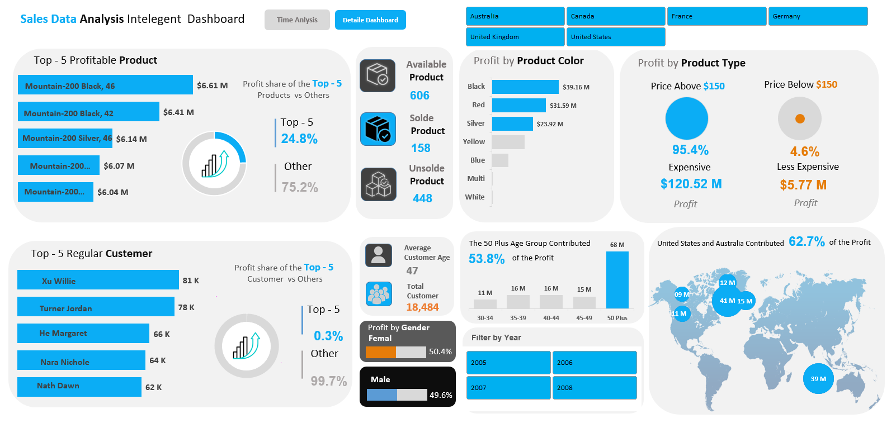
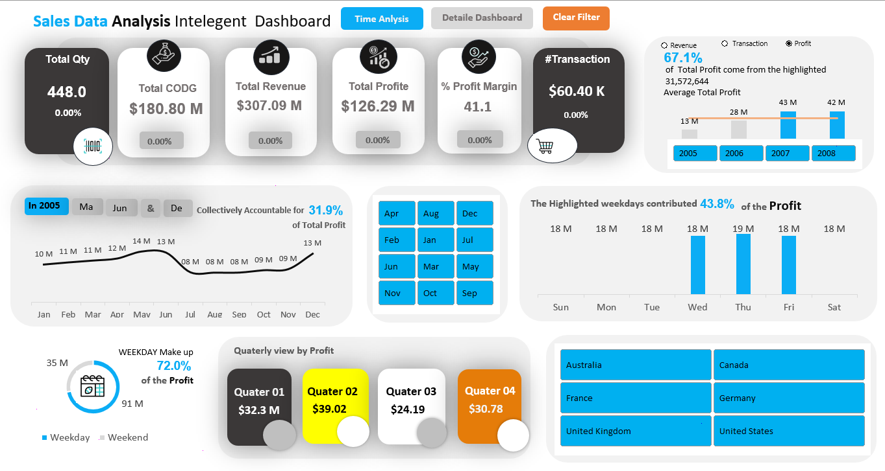

# 📊 Sales Intelligent Dashboard (Excel & AdventureWorks)

[](#)
[](#)
[](#)

An interactive, highly dynamic Excel dashboard built on the AdventureWorks dataset. This project demonstrates advanced Excel data modeling, star-schema design, parameter-driven KPIs, and dynamic visualizations to track revenue, profit margins, time series trends, and customer behaviors.


 🖼️ Dashboard Preview


> *💡 Tip: Click the image below to view a full-resolution version.*


<a href="./images/dashboard-preview.png" target="_blank">
  
</a>


 🚀 Interactive Navigation

<details>
<summary><b>📁 Click here to view the Repository Structure</b></summary>

```text
📦 Sales-Intelligent-Dashboard-Using-EXCEL
 ┣ 📂 datasets          # Contains AdventureWorks raw data/Excel files
 ┣ 📂 docs              # Helper sheets, documentation, and business reqs
 ┣ 📂 image_icons       # Icons used for KPI cards and buttons
 ┣ 📂 images            # Dashboard screenshots and visual assets
 ┗ 📄 README.md         # Project documentation
```
</details>


<details>
<summary><b>⚙️ Click here to view Core Features & Business Requirements</b></summary>

*   Dynamic KPI Engine: Single parameter selection (`Analysis!D14`) drives all metrics across the dashboard (Profit, Revenue, COGS, Transactions).
*   Time Series Analysis: Quarter-over-quarter comparisons (`GETPIVOTDATA` pulling from dynamic cube/cache fields).
*   Product Insights: Top-5 product revenue drivers vs. "Others" using dynamic arrays (`SORT`/`TAKE`) for scalable ranking.
*   Customer Demographics: Age-group and gender profit contribution breakdown.
*   Data Validation: Prevents silent lookup failures (`IFERROR` audits), ensuring 100% data integrity.
</details>


 🖼️ Dashboard Preview


> *💡 Tip: Click the image below to view a full-resolution version.*


<a href="./images/dashboard-preview.png" target="_blank">
  
</a>


 🛠️ How to Use This Workbook

1. Download the repository and open the main `.xlsx` file.
2. Enable Data Connections if prompted by Excel (Data Model / Power Pivot).
3. Refresh Data: Go to `Data ➔ Refresh All` to ensure all PivotTables are up to date.
4. Interact with the Dashboard: 
   * Use the Year Selector (or Data Slicers) to filter metrics.
   * Hover over KPI cards (powered by `GETPIVOTDATA`) to see the underlying cell formulas.


 📂 What's Inside the Folders?

*   `/datastes`: The raw AdventureWorks CSV/Excel exports used to build the Data Model.
*   `/docs`: Contains the logic blueprint, including the `Helper Sheet` layout, business requirements, and formula documentation.
*   `/image_icons`: Custom UI assets used in the dashboard's interactive buttons and KPI headers.
*   `/images`: Screenshots used for this README and portfolio presentation.


 🧠 Architecture & Formulas
This dashboard relies on a Star Schema Data Model:
*   Fact Table: Sales (Transactions, COGS, Profit).
*   Dimensions: `DimDate`, `DimProduct`, `DimCustomer`.

Core Formula Example (Dynamic KPI Engine):
```excel
=IF($D$14=1, C16, IF($D$14=2, D16, IF($D$14=3, E16, "")))
```
*Reads the selected metric from the control panel and dynamically shifts the KPI cards.*


 👨💻 Author

[Your Name/Username]
*   LinkedIn: [Your Profile](#)
*   GitHub: [@YourHandle](#)

 📜 License
This project is licensed under the MIT License - see the LICENSE file for details. Data sourced from Microsoft's AdventureWorks sample database.
